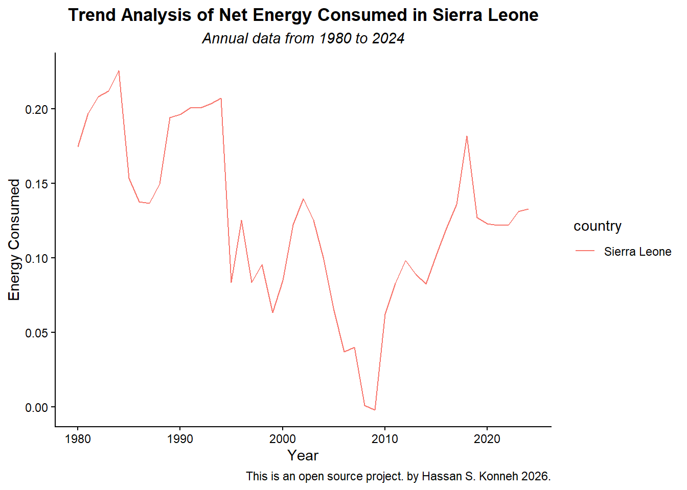

# Energy Time-Series Analysis of Mano River Union Countries

An R and Quarto project for exploring annual electricity net consumption in three Mano River Union (MRU) countries:

- Guinea
- Liberia
- Sierra Leone

The project covers data import, cleaning, transformation into a tidy time-series format, and trend visualization for the period from 1980 through 2024.

## Project Overview

The analysis uses one CSV file for each country, reshapes the data into a common table, converts it into a `tsibble`, and produces annual trend charts. The included HTML report is an executable documentation of the exploratory analysis and can be reproduced from the Quarto source.

The most recent rendered analysis is available at [Data Wrangling and time series Analysis.html](./Data%20Wrangling%20and%20time%20series%20Analysis.html).



*Example output: annual trend in Sierra Leone electricity net consumption.*

## Key Results and Outputs

The current report demonstrates:

- Import of annual country-level electricity data.
- Selection and removal of report metadata columns.
- Conversion of wide-format year columns into observations.
- Joining all three country series into one long-format dataset.
- Conversion of the tidy dataset to a `tsibble`.
- Country-specific trend plots.
- Optional smoothing with a 95% confidence interval.

The generated smoothing chart is available as [a second figure](./Data-Wrangling-and-time-series-Analysis_files/figure-html/unnamed-chunk-5-1.png).

## Dataset

| File | Country | Period | Measure |
|---|---|---|---|
| `dataSource/Energy_consump_GUI.csv` | Guinea | 1980-2024 | Electricity net consumption |
| `dataSource/Energy_consump_LIB.csv` | Liberia | 1980-2024 | Electricity net consumption |
| `dataSource/Energy_consump_SL.csv` | Sierra Leone | 1980-2024 | Electricity net consumption |

Each CSV records the measure in **billion kilowatt-hours (billion kWh)**. The source files also contain metadata and one value row for each country.

The final analytical dataset has the following conceptual structure:

| Column | Type | Description |
|---|---|---|
| `date_year` | Integer | Observation year |
| `country` | Character | Country name |
| `energy_consumption` | Numeric | Electricity net consumption in billion kWh |

## Analysis Workflow


### Data preparation steps

1. Read each CSV while skipping the report header.
2. Remove API and unused metadata columns.
3. Remove the intermediate description row.
4. Transpose each country table so that years become observations.
5. Create a row index and join the three country series.
6. Remove the index and convert the year column to integer form.
7. Pivot the country columns into `country` and `energy_consumption` fields.
8. Create a keyed annual `tsibble` using year and country.

## Repository Structure

```text
.
|-- README.md
|-- LICENSE
|-- Data Wrangling and time series Analysis.qmd
|-- Data Wrangling and time series Analysis.html
|-- Project scafold file.R
|-- dataSource/
|   |-- Energy_consump_GUI.csv
|   |-- Energy_consump_LIB.csv
|   `-- Energy_consump_SL.csv
`-- Data-Wrangling-and-time-series-Analysis_files/
    `-- figure-html/
        |-- unnamed-chunk-3-1.png
        `-- unnamed-chunk-5-1.png
```

| Path | Purpose |
|---|---|
| `Data Wrangling and time series Analysis.qmd` | Main reproducible Quarto analysis |
| `Data Wrangling and time series Analysis.html` | Rendered website/report |
| `Project scafold file.R` | Earlier exploratory R script |
| `dataSource/` | Country-level source CSV files |
| `Data-Wrangling-and-time-series-Analysis_files/` | Rendered report assets and figures |

## Requirements

This project was developed for R and Quarto on Windows.

### Software

- R 4.x or newer
- RStudio or a compatible R environment
- Quarto CLI

### R packages

```r
install.packages(c(
  "tidyverse",
  "dplyr",
  "readr",
  "tsibble",
  "feasts",
  "mixtime",
  "ggtime"
))
```

Package availability can vary by R version and operating system. Install missing packages only as required.

## Setup and Reproduction

1. Clone or download this repository.
2. Open R or RStudio from the repository directory.
3. Install the required R packages listed above.
4. Open `Data Wrangling and time series Analysis.qmd`.
5. Render the document with Quarto.

From a terminal, run:

```powershell
cd "C:\path\to\Energy_timeSeriesAnalysis_of_mru_countries"
quarto render "Data Wrangling and time series Analysis.qmd"
```

The rendered report will be written to `Data Wrangling and time series Analysis.html`.

To preview and edit the report interactively:

```powershell
quarto preview "Data Wrangling and time series Analysis.qmd"
```

## Viewing the Report

Open `Data Wrangling and time series Analysis.html` in a web browser. In VS Code, right-click the file and select **Reveal in File Explorer**, then open it from the file system.

## Methods

The visualizations use annual observations rather than a seasonal or calendar model. `tsibble` provides the time-series data structure, while `ggplot2` and related packages generate trend plots and smoothers.

The smoothing operation:

- Uses a span of `0.25`.
- Displays a 95% confidence band.
- Is descriptive and does not constitute a formal forecast.

No ARIMA, exponential smoothing, structural-break, or cross-validation model is currently implemented in the main Quarto report.

## Data Considerations and Limitations

- The project is exploratory and does not establish causal relationships.
- Small data changes or reporting revisions can affect trend shape.
- The CSV files use net electricity consumption values; they do not represent all energy production or total final energy use.
- Missing or unusual values should be checked before interpreting exact historical changes.
- The smoothing curve is an analytical aid, not an inferential forecast.
- The report currently contains no uncertainty analysis for country-level differences.

## Reproducibility Notes

- Run the Quarto document from the project root so relative file paths resolve correctly.
- Preserve the CSV filenames and the existing `dataSource` directory structure.
- Use the same source files when comparing regenerated figures.
- Document package versions when publishing formal findings or moving to a production pipeline.

## Contributing

Contributions are welcome. Suitable improvements include:

- Adding data-source and update metadata.
- Implementing missing-value and outlier diagnostics.
- Adding comparative plots across all three countries.
- Testing forecasting models with out-of-sample validation.
- Adding automated checks for data shapes and expected date coverage.
- Improving cross-platform path handling.

Before submitting substantial changes, test both the Quarto rendering and the HTML output.

## License

This project is licensed under the Apache License 2.0. See [LICENSE](./LICENSE) for the full terms.

## Author

Hassan S. Konneh
